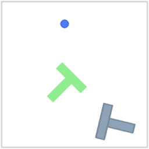
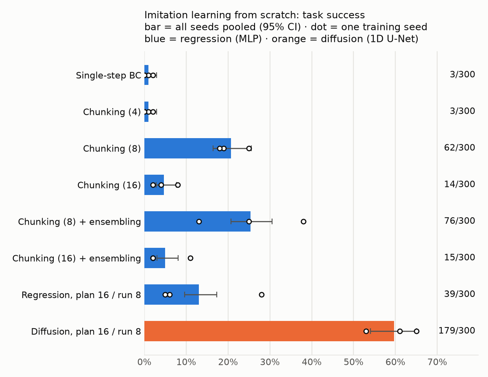
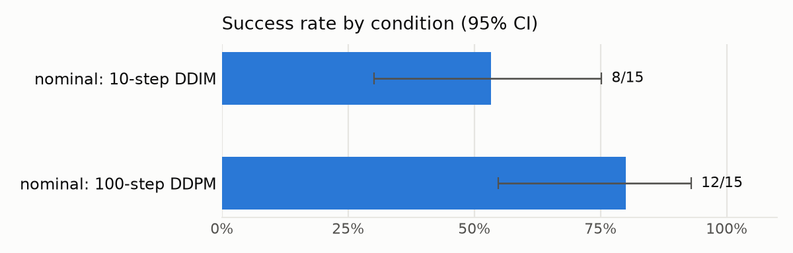
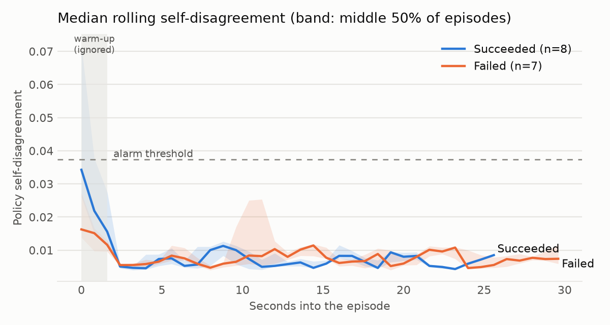

# Policy Reliability Harness

[](https://github.com/Keerthanajan08/policy-reliability-harness/actions/workflows/ci.yml)

**Train robot-learning policies from demonstrations, measure them honestly, and find out why they fail.**

On PushT (a standard robot-learning benchmark: slide a T-shaped block into a target pose), trained from scratch on the same 185 human demonstrations and evaluated on the same 100 unseen scenes × 3 training seeds:

| Policy | Task success (300 episodes, 95% CI) |
|---|---|
| Single-step behaviour cloning | 1% (0–3%) |
| + action chunking and temporal ensembling (ACT's ideas) | 25% (21–31%) |
| **Diffusion policy (1D temporal U-Net, built from scratch)** | **60% (54–65%)** |

On identical scenes, the diffusion policy fixed **133** of the best regression policy's failures and broke **30** (exact McNemar p ≈ 10⁻¹⁶). Against a regression policy with *exactly* the same planning horizon and execution, it fixed 153 and broke 13, so the gain comes from modelling the action distribution, not from any other setting.

| Single-step BC ❌ | Chunking + ensembling ❌ | Diffusion policy ✅ |
|---|---|---|
|  |  |  |

*Same scene, same starting state: scene 1005, training seed 0. Every clip is reproducible from the committed checkpoints.*

The repo has two parts:

- **Part 1: Imitation learning from scratch.** 8 policy variants × 3 training seeds × 100 scenes = **2,400 evaluated episodes**, structured as a chain of controlled ablations: does chunking help, what chunk length, does ensembling help, and does a generative model beat regression at a matched setting.
- **Part 2: Diagnosing a pretrained policy.** LeRobot's pretrained Diffusion Policy (from camera images): classify its failures, find that the fast sampler causes most of them (53% → 80% with full sampling), and test whether the policy's self-disagreement predicts failure (it doesn't, and the failure analysis explains why).

Every rate carries a Wilson 95% interval, and every "better" is a **paired comparison on identical scenes** (exact McNemar test), not two noisy averages.

## Part 1: Imitation learning from scratch

**Setup.** Observations are the T-block's 8 keypoints plus the pusher's position (PushT's state-based variant). Actions are target positions for the pusher. All variants use 2 frames of observation history and the same demonstration split: 185 for training and 21 held out. The regression variants share one network (a 3-layer MLP, 512 units, LayerNorm, GELU, L1 loss) and differ only in **what they predict and how predictions are executed**:

- **Single-step BC:** predict the next action.
- **Chunking (k):** predict the next *k* actions and execute them all before asking again.
- **Chunking + temporal ensembling:** predict *k* actions every step, and execute an exponentially weighted average of every chunk's prediction for the current step (ACT's scheme).
- **Plan 16 / run 8:** predict 16 actions, execute the first 8, then re-plan (Diffusion Policy's setting).

The **diffusion policy** uses that same plan 16 / run 8 setting, but instead of regressing the action chunk it *samples* one. It starts from random noise and denoises it into a chunk, conditioned on the observations. The denoiser is a conditional 1D U-Net (temporal convolutions over the chunk, FiLM-conditioned on the observations and diffusion step), written from scratch in [`diffusion.py`](policy_reliability/imitation/diffusion.py) and scaled down from Diffusion Policy's to 1.3M parameters so it trains on a CPU. Training uses 100-step DDPM, a squared-cosine schedule, noise prediction and EMA weights. At run time it samples with 10-step DDIM.



| Variant | Success (300 episodes, 95% CI) | Per training seed |
|---|---|---|
| Single-step BC | 1% (0–3%) | 2%, 1%, 0% |
| Chunking (4) | 1% (0–3%) | 1%, 2%, 0% |
| Chunking (8) | 21% (16–26%) | 19%, 18%, 25% |
| Chunking (16) | 5% (3–8%) | 4%, 2%, 8% |
| Chunking (8) + ensembling | 25% (21–31%) | 38%, 13%, 25% |
| Chunking (16) + ensembling | 5% (3–8%) | 2%, 2%, 11% |
| Regression, plan 16 / run 8 | 13% (10–17%) | 6%, 5%, 28% |
| **Diffusion, plan 16 / run 8** | **60% (54–65%)** | **65%, 61%, 53%** |

**What the ablations show:**

- **Action chunking is the difference between a regression policy that works and one that doesn't.** Single-step BC almost never succeeds (1%); predicting 8-step chunks reaches 21% (61 scenes fixed, 2 broken, p ≈ 4×10⁻¹⁶). PushT demonstrations are *multimodal*: the same state can be pushed from the left or the right. A single-step regressor averages those modes into a hesitant in-between action; a chunk at least commits to one coherent motion for a while.
- **Chunk length has a sweet spot.** 4 steps is too short to commit (1%), 16 executes too long without feedback (5%), and 8 (0.8 s) works best.
- **Temporal ensembling is neutral to slightly positive, not the cause of anything.** At chunk 8: 25% vs 21% (52 fixed vs 38 broken, p = 0.17), with large seed-to-seed variance. A first run that changed chunk length *and* ensembling at once made ensembling look harmful. Separating the two factors showed that chunk length 16 was responsible.
- **Regression has a ceiling; a generative model breaks through it.** At an identical horizon and execution, regression reaches 13% and diffusion 60% (153 fixed, 13 broken, p ≈ 10⁻³¹). Chunking only *mitigates* mode averaging. Sampling a chunk from the learned distribution *removes* it, so every chunk is something a demonstrator could actually have done.
- **The remaining diffusion failures are about precision, not strategy.** 104 of its 121 failures got the block to ≥ 90% of the success bar at some point, then lost it in the final adjustment. That's the same failure type Part 2 traces to the fast sampler, so finer sampling on the final approach is the obvious next test.

### What it took to get there

The first diffusion policy used an MLP denoiser on the flattened action chunk. Its samples matched held-out demonstrations closely (first action within ~7 px), yet it succeeded in **1 of 50** scenes. Watching rollouts showed why: it pushed the block to nearly the right pose, then over-corrected. Sampling with 50 DDIM steps instead of 10 didn't help (0 of 20), so it wasn't the sampler. Switching to a **1D temporal U-Net**, whose convolutions over neighbouring time steps make chunks smooth and consistent, took the same training budget to **20 of 50**, and longer training to 60% overall.

One more lesson: **validation loss is not a model-selection signal for diffusion policies.** From epoch 100 to 250 the held-out denoising loss *rose* (0.034 → 0.041 on all three seeds), while task success on the same 50 scenes went from 20 to 30 of 50 (seed 0; the shorter run used its own learning-rate schedule). So the diffusion checkpoints are the final EMA weights, as in Diffusion Policy, not the lowest validation loss.

Full tables, including every paired comparison: [`results/imitation/report.md`](results/imitation/report.md).

## Part 2: Diagnosing a pretrained diffusion policy

The policy under test is [LeRobot](https://github.com/huggingface/lerobot)'s pretrained **Diffusion Policy for PushT** (`lerobot/diffusion_pusht`), which works from 96×96 camera images and the pusher's position.

### Findings (nominal condition, 15 identical starting scenes per variant)

#### 1. The fast sampler causes most of the failures: full sampling raises success from 53% to 80%



| Sampler | Success (95% CI) | Near-miss failures | Lost the block | Denoising passes per decision |
|---|---|---|---|---|
| 10-step DDIM (common fast deployment) | 8/15 · 53% (30–75%) | 5 | 2 | 10 |
| 100-step DDPM (the checkpoint's original) | **12/15 · 80% (55–93%)** | 1 | 2 | 100 |

- **Paired on the same 15 scenes:** 100-step sampling **fixed 4 failures and broke none** (exact McNemar p = 0.125: consistent, but 15 scenes isn't enough to call it conclusive).
- **It fixes exactly the failure type you'd expect:** near misses (the T stalls at ~91–94% covered, just short of the 95% bar) dropped from **5 to 1**. "Lost the block" failures stayed at 2: those aren't a precision problem.
- **The trade-off:** 10× more denoising compute per decision. On a robot, that's latency budget; the practical options are a GPU, fewer but better steps, or full sampling only on the final approach, where precision matters.

Same starting scene, the two samplers:

| 10-step DDIM: near miss ⚠️ | 100-step DDPM: success ✅ |
|---|---|
|  |  |

#### 2. The policy's self-disagreement doesn't predict its failures, because most of them are confident

With the fast sampler, **5 of 7 failures were near misses** in which the policy wasn't uncertain, just imprecise: its samples agreed on the imprecise motion. Their peak self-disagreement (median 0.0152) was no higher than in successful episodes (0.0167); only the 2 "lost the block" failures showed more (0.0309). So early disagreement doesn't separate failures from successes (**AUROC 0.34**, below chance), and the alarm flagged **2 of 7 failures** at a cost of **1 false alarm in 8 successes**.



**Together:** the dominant failure mode here was a *deployment setting*, not something an uncertainty monitor could see. Classifying failures first (near miss vs lost) is what pointed to the fix.

> **In progress:** the two perturbed conditions (`sensor_noise`, `actuation_noise`). Sensor noise in particular may produce more "lost the block" failures, which is where an uncertainty signal has a chance to help.

Full tables: [`results/report.md`](results/report.md). Raw per-step data: [`results/episodes.jsonl`](results/episodes.jsonl).

### How the uncertainty signal works

A diffusion policy doesn't output one action; it *samples* one, by denoising random noise into an action chunk (8 future steps). So at every decision, the harness:

1. Encodes the camera images and state **once**.
2. Samples **K = 3 candidate action chunks** from the same observation with different noise.
3. **Executes the first candidate**, exactly what the unmodified policy would do, so behaviour is unchanged.
4. Records the **spread between the candidates** (mean standard deviation across samples, in the policy's normalised action space) as its *self-disagreement*.

The **alarm** fires when the 3-decision rolling mean of self-disagreement crosses a threshold, after a short warm-up (the first 2 decisions, ~1.6 s, where every episode starts out uncertain). The threshold is set from a **false-alarm budget**: at most 10% of *successful nominal* episodes may ever trigger it. It's calibrated on nominal data only, then applied unchanged to the perturbed conditions, so those are an out-of-sample test.

### Test conditions

| Condition | What changes |
|---|---|
| `nominal` | Nothing: the policy as trained |
| `sensor_noise` | Camera noise (σ = 20/255 per pixel) and position-sensor noise (σ = 4 px) |
| `actuation_noise` | The executed target position is off by σ = 12 px (of a 512 px workspace) |

Each condition uses the same episode seeds, so every condition starts from the same scenes. Perturbation noise and diffusion sampling noise are seeded too, so every run is reproducible.

### Metrics

- **Success rate** with a **Wilson 95% interval**, which stays honest at small sample sizes where "p ± 2σ" doesn't.
- **Time to success** (median, successful episodes only) and **final progress**: PushT's reward, which is the share of the target the T covers divided by the 95% success bar, capped at 1. So 0.97 means ~92% covered, close but not a success.
- **Failure type:** a failure ending at progress ≥ 0.9 is a *near miss*; anything lower means the policy *lost the block*.
- **Early-warning AUROC:** whether mean self-disagreement over the first ~4.8 s separates episodes that go on to fail from ones that succeed (0.5 means no signal, 1.0 means perfect).
- **Alarm:** the share of failures flagged, how long before the end of the episode the flag came, and false alarms on successful episodes (the cost: a human called in unnecessarily).

## Reproduce

```bash
python -m venv .venv && source .venv/bin/activate
pip install -r requirements.txt --extra-index-url https://download.pytorch.org/whl/cpu

# Evaluate (re-runs skip finished episodes, so you can stop and resume any time)
python -m policy_reliability.run --condition nominal         --seeds 0-14 --clips results/clips
python -m policy_reliability.run --condition sensor_noise    --seeds 0-14 --clips results/clips
python -m policy_reliability.run --condition actuation_noise --seeds 0-14 --clips results/clips

# Sampler ablation: the original 100-step sampler, success rate only (~10x slower)
python -m policy_reliability.run --condition nominal --sampler ddpm100 --samples 1 --seeds 0-14 --clips results/clips

# Tables + charts
python -m policy_reliability.report

# Part 1: imitation learning. Regression variants: ~90 s to train on a CPU.
for seed in 0 1 2; do
  for v in bc_single_step chunk4 chunk8 chunk16 chunk8_ensemble chunk16_ensemble chunk16_exec8; do
    python -m policy_reliability.imitation.train --variant $v --seed $seed
    python -m policy_reliability.imitation.evaluate --checkpoint models/imitation/${v}_seed${seed}.pt --scenes 1000-1099
  done
  # Diffusion policy: ~1 hour per seed on 2 CPU cores (minutes on a GPU)
  python -m policy_reliability.imitation.train --variant diffusion --seed $seed --epochs 250
  python -m policy_reliability.imitation.evaluate --checkpoint models/imitation/diffusion_seed${seed}.pt --scenes 1000-1099
done
python -m policy_reliability.imitation.report

pytest   # metrics, reports, data windows, chunking, ensembling, diffusion sampling (no simulator needed)
```

On a small CPU an episode takes about 1–4 minutes; failed episodes are the slow ones, since they run the full 300 steps. The pretrained weights download from the Hugging Face Hub on first run.

`models/diffusion_pusht/` holds the policy's normalisation statistics, converted to the processor format LeRobot 0.6 expects (the Hub checkpoint predates it), using LeRobot's own `migrate_policy_normalization` script.

## Design decisions

- **The executed action is untouched.** Uncertainty comes from extra samples alongside the real one, so the monitor observes the policy without changing what it does.
- **The images are encoded once per decision**, not once per sample; only the cheap denoising loop is repeated K times.
- **Fast sampling by default, with the original as an ablation.** The harness defaults to 10-step DDIM (a common way to deploy diffusion policies faster); `--sampler ddpm100` runs the checkpoint's original 100-step DDPM on the same seeds, which is how finding 1 was measured. The uncertainty signal is only compared within one sampler, since disagreement scales differ between samplers.
- **Calibrate on nominal, test on perturbed.** The alarm threshold never sees the perturbed conditions, so their alarm numbers are out-of-sample.
- **Paired comparisons, not just averages.** Both samplers run the same 15 scenes, so the comparison counts fixed vs broken scenes (McNemar) instead of comparing two noisy averages.
- **Report the negative result.** An early run of 6 episodes suggested the alarm caught every failure; the full 15 showed it doesn't. Small samples mislead, which is why every rate here carries a confidence interval.

## Limitations

- **Simulation, one task.** PushT is a standard benchmark, but real deployments add contact dynamics, lighting and hardware faults it doesn't model.
- **Part 1 uses state observations.** That keeps training CPU-friendly and the ablations clean, but it isn't vision-based learning; the same comparison with image inputs needs a GPU. The diffusion policy is also a scaled-down U-Net trained for 250 epochs; the published Diffusion Policy trains a much larger network far longer, so 60% is a CPU-budget result, not its ceiling.
- **Small samples.** 15 episodes per condition gives wide intervals. The harness is resumable precisely so this can be scaled up.
- **One uncertainty signal.** Sample disagreement is cheap and policy-agnostic for generative policies. Ensembles, action-chunk consistency over time and learned failure classifiers are natural comparisons.

## Next steps

- **Close the last gap in Part 1:** most remaining diffusion failures are near misses lost in the final adjustment. Test finer sampling (DDPM-100, or more DDIM steps only on the final approach), the fix Part 2 found for the same failure type, paired on the same 300 episodes.
- **Scale the diffusion policy:** a wider U-Net and longer training on a GPU, plus image observations.
- **Finish the perturbed conditions:** does uncertainty become predictive when failures are "lost the block" rather than near misses?
- **Cheaper precision:** full sampling only on the final approach, or 20–50 DDIM steps, to recover most of the 80% at a fraction of the compute. Measured the same way: same seeds, paired.
- **More scenes:** scale to 50+ scenes per variant to make the sampler result statistically conclusive.
- Turn alarms into an **intervention policy** (pause, re-plan or hand over to a human) and measure success *with* interventions versus their cost.

## Project structure

```
policy_reliability/
  policy.py       LeRobot Diffusion Policy, DDIM-10 / DDPM-100 samplers, multi-sample self-disagreement
  conditions.py   nominal / sensor_noise / actuation_noise perturbations
  run.py          resumable evaluation runner: one JSON line per episode, optional GIFs
  metrics.py      Wilson intervals, exact McNemar, AUROC, rolling alarm, lead time (pure Python)
  report.py       results/report.md + charts: sampler comparison, failure types, alarm
  imitation/
    data.py       demonstrations -> (observation history, action chunk) pairs, split by episode
    model.py      MLP policy; open-loop chunk execution and ACT-style temporal ensembling
    diffusion.py  diffusion policy: conditional 1D U-Net denoiser, DDPM training, DDIM sampling
    train.py      regression (L1, best-on-validation) and diffusion (EMA, final weights) training
    evaluate.py   resumable rollouts on fixed evaluation scenes
    report.py     results/imitation/report.md + chart, paired comparisons
    clip.py       render a rollout to a GIF
models/diffusion_pusht/   normalisation stats in LeRobot 0.6 processor format
models/imitation/         the three checkpoints used in the clips
results/                  episodes.jsonl, report.md, charts, clips
tests/                    metrics, reports, conditions, data windows, chunking, ensembling, diffusion
```
